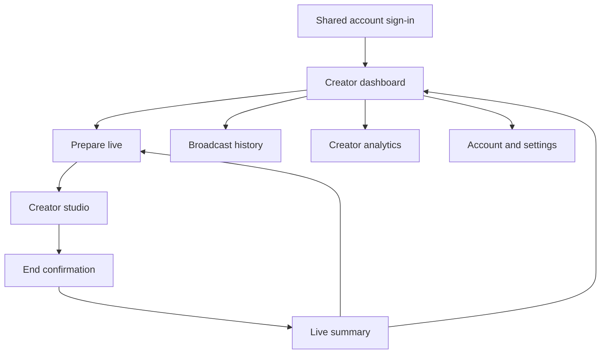

# LiveJP Creator — Design Specs

## 1. Product intent

LiveJP Creator is a Japanese-language broadcasting companion for creators. Viewers do not discover or watch livestreams inside this app; they watch through a separate audience app.

The design has two jobs:

1. Help any creator start a reliable livestream with minimal setup.
2. Give creators clear, motivating feedback about how many people watched.

### Confirmed constraints

- Creator-only iOS and Android application.
- Shared account with the existing website/main app.
- Sign-in by email or phone number.
- Every creator account may livestream.
- Viewers watch and interact from a separate app.
- Free product; no wallet, tickets, tips, subscriptions, or checkout.
- No adult content, promotion, or external adult links.
- Backend, streaming infrastructure, and API contracts are out of scope.

### Temporary design assumptions

- The shared account identifies an eligible creator after sign-in.
- The audience app supplies live viewer counts and comments to the creator studio.
- MVP broadcasts are public in the audience app.
- Creator selects one general-audience category before going live.
- Scheduling, co-hosting, replay editing, gifts, private rooms, and monetization are excluded.

## 2. Design direction and atomic tokens

### Theme

**Creator Control Room** — dark, calm surfaces keep the camera preview prominent; violet is used for creation actions, coral only for the live state, and cyan/green communicate connection health.

### Color tokens

| Token | Value | Usage |
|---|---:|---|
| `color.bg` | `#0B0D18` | App background |
| `color.surface` | `#151829` | Cards and sheets |
| `color.surfaceRaised` | `#20243A` | Inputs and elevated controls |
| `color.primary` | `#7C5CFF` | Main creation CTA |
| `color.live` | `#FF6B7A` | Broadcasting and destructive emphasis |
| `color.cyan` | `#59D9E8` | Audience data highlight |
| `color.success` | `#55D6A0` | Connection and permission success |
| `color.text` | `#F7F7FC` | Primary text |
| `color.textMuted` | `#A5A9BE` | Secondary text |

### Typography and layout

- Font stack: `Hiragino Sans`, `Yu Gothic`, `Noto Sans JP`, system sans-serif.
- Display 28/36, H1 22/28, H2 17/24, body 14/21, caption 11/16.
- 8 px spacing grid, 20 px screen gutters, 16–24 px card radius.
- Minimum touch target: 44 × 44 px.
- Japanese copy is short and operational; no Lorem Ipsum.

### Core components

- `BroadcastStatus`: Offline, Connecting, Live, Reconnecting.
- `ReadinessCheck`: Camera, microphone, connection, guideline status.
- `ViewerMetric`: current, peak, and unique viewer values.
- `CreatorMetricTile`: broadcasts, total viewers, average watch time.
- `StudioControl`: camera switch, mic, effects, comment moderation.
- `BroadcastHistoryRow`: date, duration, unique/peak viewers.
- `BottomNav`: Dashboard, History, raised Go Live, Analytics, Account.

## 3. Information architecture

Viewer discovery, viewer playback, following, reactions, and viewer profiles are explicitly outside this app.

## 4. Screen inventory

| ID | Screen | Purpose | Required states |
|---|---|---|---|
| `AUTH-01` | Sign in | Use shared account via email or phone | Email, phone, validation, loading |
| `DASH-01` | Creator dashboard | Show broadcast status, recent performance, and fastest route to Go Live | Ready, first-time, permission issue |
| `CREATE-01` | Prepare live | Preview camera and configure title/category | Ready, missing title, permission denied, weak network |
| `STUDIO-01` | Creator studio | Broadcast while monitoring viewers, comments, and connection | Live, reconnecting, comments hidden |
| `STUDIO-02` | End confirmation | Prevent accidental stream termination | Default, ending |
| `SUMMARY-01` | Live summary | Show viewer results and encourage the next broadcast | Normal, zero-viewer session |
| `HISTORY-01` | Broadcast history | Review prior live sessions | Populated, empty |
| `ANALYTICS-01` | Creator analytics | Summarize viewer trend and creator consistency | 7-day, 30-day, insufficient data |
| `ACCOUNT-01` | Account | Shared account identity, permissions, guidelines, help | Signed in, permission warning |

## 5. Critical creator flow

`Sign in → Dashboard → Prepare live → Readiness confirmed → Start → Studio → End confirmation → Summary`

Design targets:

- Returning creator reaches camera preview in one tap from Dashboard.
- Creator can start within 30 seconds, excluding OS permissions.
- Current viewer count and connection health remain visible throughout the stream.
- Ending always requires explicit confirmation.

## 6. KPI alignment

| KPI | Design decision | Later instrumentation event |
|---|---|---|
| Live viewers | Studio keeps current viewers visible without blocking camera | `studio_viewer_count_seen` |
| Live viewers | Summary leads with unique and peak viewers | `summary_viewed` |
| Active creator ratio | Raised Go Live action persists in primary navigation | `prepare_live_open` |
| Active creator ratio | Preflight is one short screen with four readiness checks | `start_live_attempt`, `start_live_success` |
| Active creator ratio | Dashboard and summary show consistency nudges | `go_live_again`, `creator_return_7d` |

Metric definitions for a later analytics phase:

- `Live viewer`: unique account in the separate audience app watching at least 10 seconds.
- `Active creator`: creator completing at least one stream lasting 60 seconds or more during the measurement period.
- `Active creator ratio`: active LiveJP creators divided by creators active in the main app during the same period.

The product-level active creator ratio belongs in an internal business dashboard, not in the creator-facing app.

## 7. Trust and moderation design

- Community guidelines are acknowledged before first broadcast and summarized in preflight.
- Studio includes comment moderation access because comments originate in the audience app.
- Creator can hide comments without interrupting the stream.
- Camera/microphone permissions always explain why they are required.
- Titles, category, camera video, and incoming comments are treated as UGC requiring later moderation implementation.

## 8. Micro-interactions

- Live dot pulses at 1.6 seconds; reduced-motion disables it.
- Go Live changes `Ready → Connecting → Live` without moving position.
- Viewer count crossfades without changing layout width.
- Connection changes use color plus text, never color alone.
- Screen transitions run 180–240 ms.

## 9. Platform adaptation

- iOS: safe areas, native permission copy, sheet-style confirmations, swipe-back where safe.
- Android: edge-to-edge layout, system back/predictive back, Material permission flow.
- Shared tokens and information architecture remain identical.

## 10. Prototype coverage

The local prototype covers:

- Email/phone sign-in.
- Creator dashboard.
- Prepare → Studio → End → Summary.
- Broadcast history, creator analytics, and account settings.

See [Prototype/README.md](Prototype/README.md).
